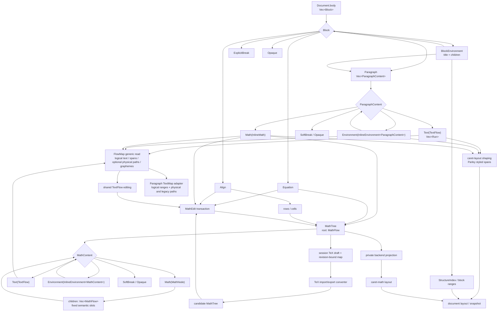

# Block、正文与公式内容的代码链路

更新日期：2026-11-09。本文定义内容模型的目标职责链路；实现进度与验证证据以对应任务为准。持久化语义以[文档树与结构](document-structure.md)及[文档存储](document-storage.md)为准，行内/块级载体的适配规则以[环境视图](environment-views.md)为准，Block 交互协议以[块宿主交互](block-interaction.md)为准，数学模型和 `\text` 转换规则以[数学公式](../math.md)为准。

## 文档模型与消费者

`ParagraphContent` 与 `MathContent` 是两个由宿主约束的强类型流。二者只共用 `TextFlow` 和泛型 `InlineEnvironment<Child>` 包装；段落公式、块公式、对齐单元仍保留各自的宿主身份、位置和事务边界。MathNode 的每个固定操作数槽位独立存放一个 MathFlow，不能因编辑文本流而改变槽位个数或次序。

## 编辑与排版边界

| 内容 | 共用职责 | 宿主职责 | 模块边界 |
| --- | --- | --- | --- |
| `ParagraphContent::Text(TextFlow)` | Run、Run 属性、字素位置、正文 IME 与段落 shaping | 段落位置和正文事务 | `caret-engine/src/editing/text_map.rs`、`session/inline_content.rs`、`caret-layout/src/shaping.rs` |
| `ParagraphContent::Environment` | 递归内容流、格式语义和环境范围 | InlineEnvironment ID 与包装树操作 | `editing/environment/inline_adapter/inline_environment.rs`、`session/formatting/inline_tree.rs` |
| Run 属性环境 | 与 TextFlow 共享文本位置和字形几何 | 更新所属 Run 属性，不创建包装节点 | `editing/environment/inline_adapter/inline_run_property.rs`、`editing/text_map.rs` |
| `ParagraphContent::Math(InlineMath)` | 段落原子位置、选区和行内对象布局 | MathEdit 源码模式、MathTree 和公式验证 | `editing/environment/inline_adapter/inline_math.rs`、`session/math_edit.rs`、`math_validation.rs` |
| MathFlow 中的 `TextFlow` | 与正文共用 Run、Run 属性、字素位置和范围编辑 | MathFlow 宿主路径与 MathEdit 历史事务 | `caret-engine/src/editing/flow_edit.rs`、`session/math_edit/path.rs`、`text_branch.rs` |
| `Equation` / `Align` | 与 InlineMath 共用 MathTree、解析器和公式编辑事务 | 块级宿主、Align cell 边界 | `caret-doc/src/model/math.rs`、`editing/environment/block_adapter/block_math.rs` |
| BlockEnvironment | 标题 Paragraph 复用正文模型和布局；子项递归 Block | 块父链、结构范围和块级编辑 | `caret-structure/src/index.rs`、`editing/environment/block_adapter/block_environment.rs` |

`FlowMap` 依赖泛型 `FlowContent<T>`、Run 与 InlineEnvironment；宿主提供 Math 原子的标记投影和 span 适配器。它生成 Run/原子范围、环境范围、字素边界和宿主物理路径。字素分段遵循[文档位置规范](document-position.md#位置)：Run 与 InlineEnvironment 透明，公式原子和 SoftBreak 两侧设置结构停靠点。Paragraph 与 MathFlow 适配器消费同一映射原语，并各自负责宿主路径解析、元数据校验和事务提交。MathFlow 固定操作数槽位仍由 MathEdit 以宿主路径标识，不能跨槽位展平。

`FlowMap` 以宿主物理路径表示 ParagraphContent/Environment 子向量和 TextFlow 内 Run；适配器用宿主路径解析目标节点。临时扁平视图只允许作为宿主适配器内部实现细节，不能成为另一份权威模型。共享低层 TextFlow 范围替换不负责宿主索引、元数据或历史事务；Paragraph 与 MathFlow 适配器分别解析自身宿主路径并管理提交。

正文与公式文本共用字素边界、移动、吸附、Run 范围替换和 InlineEnvironment 格式操作。TextFlow 编辑适配器处理普通文字、Run 属性和格式范围；Paragraph 与 MathFlow 宿主适配器只负责路径、元数据校验和历史提交。公式 TextFlow 中的 `\math` 通过共享流操作切分前后文本并插入 Math 分支，不经 TeX 字符串往返。TeX 源码模式是 MathTree 的临时投影，由独立转换边界提供草稿和仅在编辑会话有效的位置映射。共享编辑语义不负责宿主事务，也不单独证明性能收益。

MathEdit 的 Text 分支沿 `MathTextFlowPath` 定位 MathFlow 中的 TextFlow，并直接复用 TextFlow 编辑器；普通输入、删除和格式操作对目标流执行一次宿主事务，不经过 TeX 序列化和重解析。Paragraph 与 MathFlow 的差异限制在宿主路径与历史提交边界；相同文本操作不维护第二份格式算法。Align cell 通过行列身份和局部宿主路径定位。源码模式从 MathTree 生成临时 TeX 草稿；草稿位置通过会话级映射定位树节点。候选解析、映射或元数据归属失败时保留原文档、焦点和撤销状态。InlineMath 根层提升按结构流顺序拆分；提升递归保留单个 InlineEnvironment 包装和 ID，不穿过 MathNode 固定操作数槽位。

- `TextFlow` 是正文与公式文本岛共用的文本载体；TextContent 不作为数学文本叶片。
- InlineMath 根流中的文本在创建和源码提交时提升为 Paragraph TextFlow；MathNode 的固定操作数槽位不提升。固定槽位内的 `\math` 切分只影响所属 MathFlow。
- TextFlow 编辑直接修改 MathTree 中的共享文本流；TeX 导入/导出与临时源码编辑草稿由独立转换边界负责。失败不修改文档和焦点。
- 数学布局必须进入 Caret 页面布局、命中测试和公式光标几何；Qt/QML 只消费 Rust 快照，不重建文本或数学语义。

## 代码入口

- 模型与编解码：`crates/caret-doc/src/model/{inline,inline_environment,paragraph,math,codec,validation}.rs`
- 编辑适配与事务：`crates/caret-engine/src/editing/{flow_map.rs,flow_edit.rs,grapheme.rs,text_map.rs,environment.rs,environment/,session/inline_content.rs,session/formatting/inline_tree.rs,session/math_edit.rs,session/math_edit/inline_root_split.rs,session/math_edit/text_branch/split_tree_edit.rs,session/math_edit/text_run_split.rs}`
- 公式解析、序列化与布局后端：`crates/caret-math/src/{parser.rs,serialize.rs,backend.rs,layout.rs}`
- 正文 shaping 与分页：`crates/caret-layout/src/{paragraph.rs,shaping.rs}`、`crates/caret-engine/src/layout.rs`
- 块结构索引：`crates/caret-structure/src/index.rs`
- 页面快照：`crates/caret-app/src/document_view/snapshot.rs`
