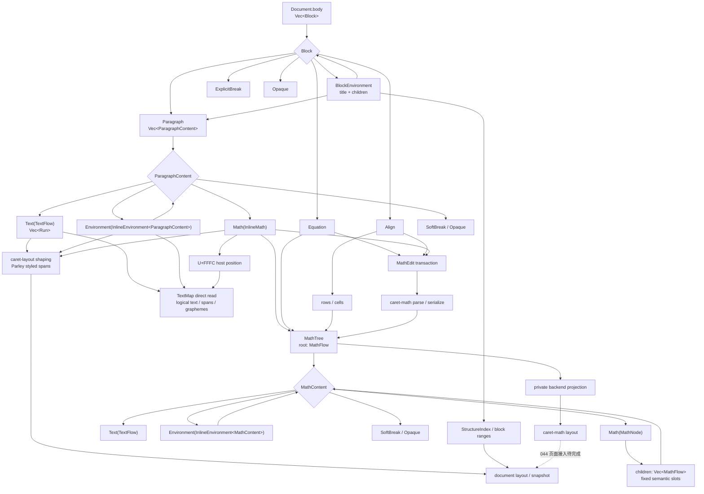

# Block、正文与公式内容的代码链路

更新日期：2026-11-01。本文记录当前模型和代码的实际调用路径；持久化语义以[文档树与结构](document-structure.md)及[文档存储](document-storage.md)为准，行内/块级载体的适配规则以[行内与块级环境适配](inline-and-block-environments.md)为准，数学模型和 `\text` 转换规则以[数学公式](../math.md)为准。

## 文档模型与消费者

`ParagraphContent` 与 `MathContent` 是两个由宿主约束的强类型流。二者只共用 `TextFlow` 和泛型 `InlineEnvironment<Child>` 包装；段落公式、块公式、对齐单元仍保留各自的宿主身份、位置和事务边界。MathNode 的每个固定操作数槽位独立存放一个 MathFlow，不能因编辑文本流而改变槽位个数或次序。

## 编辑与排版边界

| 内容 | 共用的路径 | 宿主专属路径 | 实际入口 |
| --- | --- | --- | --- |
| `ParagraphContent::Text(TextFlow)` | Run、Run 属性、字素位置、正文 IME 与段落 shaping | 段落位置和正文事务 | `caret-engine/src/editing/text_map.rs`、`session/inline_content.rs`、`caret-layout/src/shaping.rs` |
| `ParagraphContent::Environment` | 递归内容流、格式语义和环境范围 | InlineEnvironment ID 与包装树操作 | `editing/environment/inline_adapter/inline_environment.rs`、`session/formatting/inline_tree.rs` |
| Run 属性环境 | 与 TextFlow 共享文本位置和字形几何 | 更新所属 Run 属性，不创建包装节点 | `editing/environment/inline_adapter/inline_run_property.rs`、`editing/text_map.rs` |
| `ParagraphContent::Math(InlineMath)` | 段落原子位置、选区和行内对象布局 | MathEdit 源码模式、MathTree 和公式验证 | `editing/environment/inline_adapter/inline_math.rs`、`session/math_edit.rs`、`math_validation.rs` |
| MathFlow 中的 `TextFlow` | 与正文共用 Run、Run 属性和字素位置表示 | 操作数槽位内的 `MathTextFlowPath`、sourceMap 与 MathEdit 事务 | `caret-doc/src/model/inline.rs`、`model/math.rs`、`session/math_edit/path.rs`、`text_branch.rs` |
| `Equation` / `Align` | 与 InlineMath 共用 MathTree、解析器和公式编辑事务 | 块级宿主、Align cell 边界 | `caret-doc/src/model/math.rs`、`editing/environment/block_adapter/block_math.rs` |
| BlockEnvironment | 标题 Paragraph 复用正文模型和布局；子项递归 Block | 块父链、结构范围和块级编辑 | `caret-structure/src/index.rs`、`editing/environment/block_adapter/block_environment.rs` |

`TextMap::new` 直接遍历 ParagraphContent，不为只读位置查询克隆整棵行内树。正文与公式文本目前共用 `editing/grapheme.rs` 的字素边界、移动和吸附算法；两类宿主仍分别构建自己的逻辑文本范围。编辑操作目前通过 `text_map.rs` 中的临时 `EditNode` 事务视图复用既有树操作，成功后显式提交，错误时丢弃；这避免失败写回，但仍会复制被编辑段落的行内内容。它不是第二份持久化表示，性能成本也不能视为已消除。若基准确认该成本影响常见输入，应进一步改为沿宿主路径直接操作 TextFlow 与包装节点。

MathEdit 的 Text 分支沿 `MathTextFlowPath` 解析出 MathFlow 中的 TextFlow，并使用 `sourceMap` 将 UTF-8/grapheme 范围换算为源码范围。普通输入与删除先在候选 Run 序列中编辑，再解析公式源码、迁移稳定 ID/未知元数据、校验并以单次 history patch 提交；解析、映射或元数据归属失败时保留原文档和焦点。InlineMath/Equation 的源范围直接相对公式源码；Align cell 路径同时保存 cell 局部范围与 Align 宿主源码范围，范围扫描由 `math_edit/align_source.rs` 供路径和元数据迁移共用。正文和公式目前只共享字素边界算法；数学编辑尚未把相邻 TextFlow/InlineEnvironment 组成同一个逻辑文本流，因此跨内容节点的组合字素仍会被拆分。该分支目前未复用正文完整的选区、IME 和格式编辑事务；这些仍是 043 的未完成项。输入时对 MathTree 做解析和候选 Run 序列分配的成本尚未测量。

公式后端视图位于 `caret-math/src/backend.rs`，只在单次序列化或布局调用期间建立，不进入文档存储、编辑状态或兼容读取。旧的临时数学字符串节点格式没有迁移转换器；旧 schema 不被当作当前 MathTree 读取。

## 边界与尚未接入项

- `TextFlow` 是正文和公式文本岛共用的唯一文本载体；`TextContent` 不作为新持久化树的文本表示。
- 普通正文的 `\math` 根流提升、带格式包装的宿主转换，以及数学槽位内部的 Math/TextFlow 切分，目标规则见[数学公式](../math.md#宿主边界与拆分)；这些结构转换仍待 043 实现。
- 044 的公式 layout 结果尚未接入 Caret 页面布局、命中测试和公式光标几何。`caret-math` 单独布局成功不能替代这些用户可观察路径的验证。
- Qt/QML 消费 `caret-app` 快照；Run、InlineEnvironment、MathTree 和 Block 的语义由 Rust 模型、编辑器与布局模块持有。

## 代码入口

- 模型与编解码：`crates/caret-doc/src/model/{inline,inline_environment,paragraph,math,codec,validation}.rs`
- 编辑适配与事务：`crates/caret-engine/src/editing/{text_map.rs,environment.rs,environment/,session/inline_content.rs,session/formatting/inline_tree.rs,session/math_edit.rs}`
- 公式解析、序列化与布局后端：`crates/caret-math/src/{parser.rs,serialize.rs,backend.rs,layout.rs}`
- 正文 shaping 与分页：`crates/caret-layout/src/{paragraph.rs,shaping.rs}`、`crates/caret-engine/src/layout.rs`
- 块结构索引：`crates/caret-structure/src/index.rs`
- 页面快照：`crates/caret-app/src/document_view/snapshot.rs`
