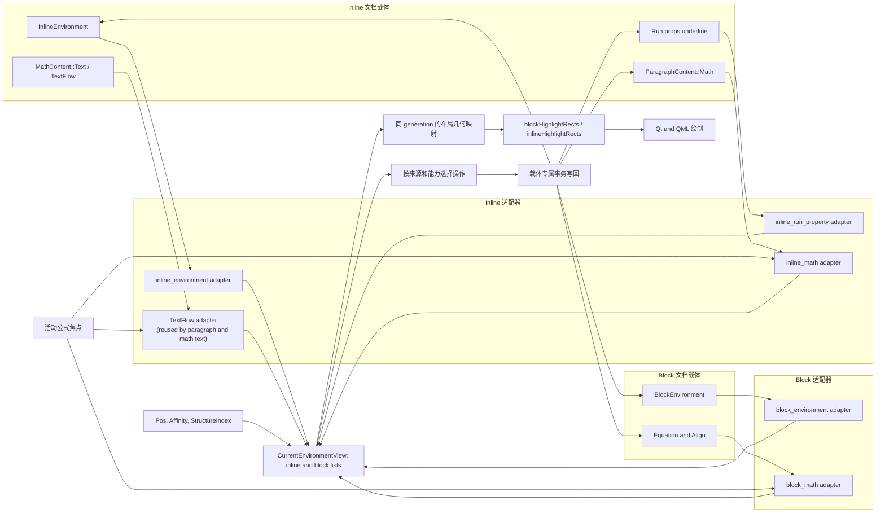

# 行内与块级环境适配

更新日期：2026-11-01。本文定义环境适配器先按宿主层级分为 Inline 与 Block，再映射各自的文档载体、焦点、操作和几何。节点字段见[文档树与结构](document-structure.md)；格式解析见[文字格式语义](../text-formatting.md)；普通块环境的标题、编号、模板和解除语义见[块环境模型](document-environments.md)。

本文定义目标适配架构；实现进度、验证和未完成项只记录在对应任务，公式编辑进度见[043](../../../task/043-math-model-and-editing.md)。适配职责链路见[内容节点代码链路](content-code-path.md)。`.cdoc` 不为早期临时格式提供兼容。本文定义语义适配边界；`ParagraphContent`、`TextFlow` 与数学持久化结构由[文档树与结构](document-structure.md)及[数学公式](../math.md)定义。

## 分层结构

适配层以宿主编辑层级为第一层。Inline 候选和 Block 候选分别查询、排序和解析几何；它们可以同时处于活动状态。第二层再按载体类型调用对应的适配逻辑：

| 层级 | 分支 | 文档载体 | 语义来源 | 交互写回 |
| --- | --- | --- | --- | --- |
| Inline | `InlineEnvironment` | 有稳定 ID、可嵌套的格式包装节点 | 插入点与环境节点范围 | 环境树事务；Bold、Italic、Font |
| Inline | `Run.props.underline` | Run 字符直接属性 | 插入点与连续 underlined Run 形成的逻辑范围 | Run 属性事务 |
| Inline | `ParagraphContent::Math` | 有稳定 ID 和独立 MathTree 的原子行内内容项 | 活动公式宿主与内部焦点 | 数学编辑事务；宿主 Paragraph 仍将其视作原子对象 |
| Inline | Math 内容流的 `Text(TextFlow)` 项 | MathTree 中的普通文本片段 | MathTree 宿主路径、活动文本流位置 | 委托共享 TextFlow 文本、Run 属性和 InlineEnvironment 事务；数学宿主适配器只负责树路径、位置映射与文档历史。仅显式 TeX 源码编辑使用会话级草稿和临时映射，见[数学公式架构](../math.md#公式中的普通文本) |
| Block | 普通块环境 | `BlockEnvironment`，例如 Section、Custom | 稳定块节点与结构范围 | 块环境事务；标题、子树、解除等规则见块环境模型 |
| Block | 数学块 | Equation、Align 等有稳定 ID 的公式块 | 活动公式宿主与公式块范围 | 数学编辑事务；宿主块流中保持原子性 |

这里的“环境视图”是查询与交互边界，不意味着这些载体具有相同的树形、可编辑性或撤销操作。`ParagraphContent::Math` 不属于格式环境：它是内容项，不包裹普通文本流；`InlineEnvironment<Child>` 是 ParagraphContent 或 MathContent 序列中的独立包装分支，不嵌在 TextFlow 中，因此可包住同宿主流的公式子项而不吸收或替代公式节点身份。数学内容流的 `Text(TextFlow)` 是公式中的文本编辑目标，不是另一种数学文本叶片；它复用普通行内文本编辑器，再由数学宿主适配器把变更写回对应树路径和历史事务。普通文本编辑不生成或同步 TeX 源码映射；源码草稿只服务显式源码编辑。根流提升及固定槽位隔离按[数学公式架构](../math.md#宿主边界与拆分)执行。

## 统一处理链路

各变种共享语义视图与几何消费契约，保留载体专属的解析、命令和写回路径。Inline 与 Block 先分层，再由各自适配器将载体映射为统一的 `EnvironmentEntry`；数学候选只有在焦点确实进入某个公式对象后才进入视图。

统一契约止于语义候选和几何投影：

- 查询阶段不访问布局；Inline 与 Block 列表独立生成，因此两层高亮可以同时存在。`InlineMath`/数学块候选必须与活动公式对象的身份匹配，普通光标仅停在对象边界时不会把公式误认成当前环境。
- 操作阶段按 `EnvironmentSource` 回到真实载体：环境树操作、Run 属性更新、公式树编辑和块结构事务各自验证并提交。不能把这些写回折叠成一个通用“改环境”函数。
- 几何阶段按候选的 ID 或逻辑范围选择布局结果：普通块环境取页内结构范围，Run/InlineEnvironment 取文本范围，行内公式取 MathBox。活动 Equation/Align 则由经过 revision 校验的 MathEdit target 匹配同代 MathFragment；活动数学 TextFlow island 使用其文本范围几何。快照保留来源，Qt ViewModel 按块/inline 视觉层合并到 `blockHighlightRects` 与 `inlineHighlightRects`。具体图层和复用契约见[画布与交互背景](../../interface/canvas-highlighting.md)。

## Inline 适配

### 行内 `InlineEnvironment`

Bold、Italic、Font 用行内包装节点表达。它们拥有稳定文档 ID 和子节点范围，可以嵌套；格式命令以环境树事务应用、拆分或解除。相交的逻辑范围不能表示成交叉树边，格式命令须在局部边界拆分，并保留已有祖先顺序和有效样式。

### `Run.props.underline`

Underline 是 glyph 装饰直接属性，不拥有子树，也不参与主题环境模板或结构嵌套。适配器沿 Paragraph 行内文档顺序累计相邻文本位置；连续且值为 `true` 的 Run 片段可以投影为一个语义范围。language、其他 props 和未知字段边界不拆分语义范围，但底层 Run 仍分别保存。

`SoftBreak`、`InlineMath` 和 Opaque 节点截断可绘制的下划线几何；它们两侧的 underlined Run 不合并为跨对象高亮范围。跨越格式环境边界时继续按逻辑文本顺序累计，因此 Underline 可以与 Bold、Italic、Font 的范围相交。

### `InlineMath`

`InlineMath` 是段落中的 U+FFFC 原子内容项，持有 Caret MathTree 和稳定 ID。公式编辑状态记录宿主、活动内容分支和分支内位置；源码模式使用 UTF-8 字节偏移，TextFlow 模式使用正文文本位置语义。两种编辑模式使用各自坐标，不能用单一源码 cursor 表示。

Inline 适配器选中当前公式对象，并用同代布局快照中的 MathBox 提供几何。宿主文本编辑仍按一个原子对象处理它；进入公式后由数学编辑事务操作树。公式节点没有普通 InlineEnvironment 的子节点，也不应伪装成格式包装节点。

### 数学文本项

Math 与 TextFlow 是同一内容序列中的分支。数学文本岛共用 Run 范围与字素基础原语；宿主适配器只负责 MathTree 路径、位置映射和文档历史事务。Math TextFlow 的 Bold、Italic、Font、Run 属性与输入法操作均委托给同宿主 Inline 适配器。普通 TextFlow 编辑直接事务性修改树，不经 LaTeX 序列化、重解析或源码映射。显式源码模式的 TeX 草稿与位置映射保存在会话状态，不属于文档节点。格式环境在各自宿主内生效：Paragraph 环境可影响其包含的 Math 原子呈现，但不得改写 MathTree；固定数学槽位中的文本样式由该 MathTree 内的环境决定。Math 内输入 `\math` 时，只在当前 MathFlow 槽位结束文本片段并插入 Math 分支，再按树路径恢复位置。InlineMath 根层提升穿过 MathFlow 根流的格式包装并保留单个包装，但不穿过 MathNode 的操作数边界。Underline 始终是 TextFlow Run 的直接属性，由独立 Run 属性适配器负责。宿主提升和固定数学槽位规则见[数学公式架构](../math.md#宿主边界与拆分)；内容树和存储结构见[文档树与结构](document-structure.md)。

## Block 适配

### 普通块环境

Section、Custom 等普通块环境通过块节点、结构索引和块环境编辑事务适配。它们可有独立标题和块子树，删除与解除有不同语义。标题、编号、模板、嵌套和保留内容提升只在[块环境模型](document-environments.md)维护。

### 数学块

Equation、Align 是公式内容块，在文档结构中拥有稳定 ID；宿主块流将它们视为原子范围，公式编辑器仍可进入内部。活动公式焦点关联到其宿主公式节点。块公式的高亮几何来自同代公式布局快照；不得把数学树塞进 Section/Custom 的块环境子树，也不得将公式内部可编辑性误写成宿主结构可拆分。活动焦点的全宽块背景与 MathText inline 高亮统一由[画布高亮架构](../../interface/canvas-highlighting.md#活动公式焦点)定义。

## 查询与几何组合

适配分两步，保持 engine 与 layout 的依赖边界：

1. Session 从文档、`Pos`/选区、结构索引和数学编辑目标推导 Inline 与 Block 语义候选。候选保留来源、节点身份（若有）、逻辑范围、层级和操作能力；Run 属性投影只带来源与范围，不生成节点 ID。
2. 布局层用匹配的 document/layout generation 将候选范围映射到页内矩形、视觉行选区、MathBox 或显示公式布局几何。没有几何的候选不输出绘制范围；过期几何不能覆盖当前状态。

语义查询不依赖布局快照。几何映射也不反向决定当前格式、焦点或可执行的编辑命令。Qt/QML 只消费两层结果并按主题绘制，不重建文档范围。

## 候选选择与操作语义

Inline 内可能有嵌套环境和交叉的 Run 属性范围，不强行拼成一棵环境树。对折叠光标的“当前 inline 环境”及 Mod+Backspace，先按 `Affinity` 过滤包含光标的候选，再仅考虑当前上下文允许且支持解除的候选；依次选择逻辑范围最短者、真实 InlineEnvironment 中深度最大者、固定 kind 顺序、文档顺序。固定 kind 顺序为 Bold、Italic、Font、Underline。公式编辑焦点属于数学命令上下文，由数学编辑器路由处理；InlineMath 不进入格式环境的解除候选。

### 键盘命令的统一仲裁

编辑器快捷键由 Session 的键盘路由统一仲裁：`keyboards/` 中对应命令处理器负责读取当前焦点与选区、判断该按键上下文并选择唯一的领域操作。领域模块提供可调用的操作和自身事务，不另行截获同一个按键，也不重复维护该按键的上下文优先级。键路由之前仍可由 Session 分派层执行跨命令通用的状态校验，例如数学编辑期间存在未完成的 IME composition 时拒绝编辑命令；这类校验不再决定快捷键的具体行为。这样快捷键的焦点迁移、pending 状态、撤销边界和失败后的状态行为都有单一入口；新增载体时只扩展候选解析或领域操作，由键盘路由决定何时调用。

例如 Mod+Backspace 由统一键盘路由区分普通文本、格式环境、Run 属性和数学焦点，并处理 command line 上下文。数学焦点时，该路由调用数学编辑器提供的公式降级操作；数学编辑器不在自己的按键入口再次处理 Mod+Backspace。数学编辑器入口只对所有编辑命令共用的 composition pending 状态做前置拒绝，不复制该快捷键的载体选择逻辑，避免各载体各自截获后造成状态迁移不一致。

普通 InlineEnvironment 与 Run 属性的 Mod+Backspace 仅在折叠光标上下文使用。公式编辑焦点是例外：对行内公式执行时，从 MathTree 生成规范 LaTeX 内容，并将整个 InlineMath 原子一次性降级为普通段落文本；文本不包含 `$...$` 或 `\math(...)` 外层定界符，也不保证保留原输入空白或命令拼写。格式或元数据不能无损表达时原子拒绝，焦点与公式保持不变。光标和选区按树到规范源码的映射迁移到正文。IME 组字、命令输入、结构选区等既有键盘仲裁优先；块环境的解除与停靠行为仍遵守块环境模型。Underline 解除时清除目标范围的直接 `underline` 字段；显式取消切换可写 `false`，这两种操作不能混淆。

格式事务先验证完整目标范围再提交；失败不改变文档、焦点、pending 样式和 Undo 状态。跨越 InlineMath 的普通文字格式选区保留公式节点，并继续格式化可处理的文字；只命中不可格式化对象时返回无变化。

## 验收范围

- InlineEnvironment、Run 下划线和 InlineMath 进入 Inline 适配；普通块环境和公式块进入 Block 适配。两层查询相互独立，块与行内高亮可以同时绘制。
- Run 下划线与环境范围交叉、相邻 Run 属性变化、软换行及公式边界均有明确的范围和几何结果。
- InlineMath、Equation、Align 保留真实文档节点身份；Run 属性派生范围不生成虚构节点身份。
- 命令写回各自权威载体；键盘上下文、Affinity、Undo/Redo、失败原子性和 document/layout generation 均有行为验证。
- `.cdoc` 早期开发格式不作为兼容验收项；格式进入稳定发布后再定义迁移契约。
