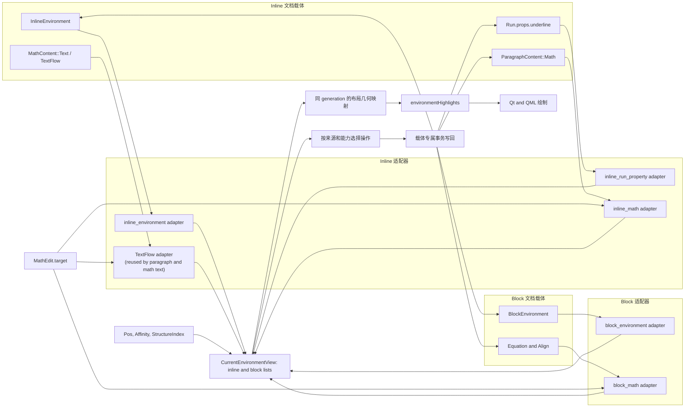

# 行内与块级环境适配

更新日期：2026-11-01。本文定义环境适配器先按宿主层级分为 Inline 与 Block，再映射各自的文档载体、焦点、操作和几何。节点字段见[文档树与结构](document-structure.md)；格式解析见[文字格式语义](../text-formatting.md)；普通块环境的标题、编号、模板和解除语义见[块环境模型](document-environments.md)。

本文是 043/044 的目标适配架构权威，相关实现随这两个任务落地。当前代码调用图见[内容节点代码链路](content-code-path.md)，其中区分已实现路径与目标接入。`.cdoc` 尚未稳定发布，不要求兼容早期分支的临时格式。本文定义语义适配边界；`ParagraphContent`、`TextFlow` 与数学持久化结构由[文档树与结构](document-structure.md)及[数学公式](../math.md)定义。

## 分层结构

适配层以宿主编辑层级为第一层。Inline 候选和 Block 候选分别查询、排序和解析几何；它们可以同时处于活动状态。第二层再按载体类型调用对应的适配逻辑：

| 层级 | 分支 | 文档载体 | 语义来源 | 交互写回 |
| --- | --- | --- | --- | --- |
| Inline | `InlineEnvironment` | 有稳定 ID、可嵌套的格式包装节点 | 当前 `Pos` 与环境节点范围 | 环境树事务；Bold、Italic、Font |
| Inline | `Run.props.underline` | Run 字符直接属性 | `Pos` 与连续 underlined Run 形成的逻辑范围 | Run 属性事务 |
| Inline | `ParagraphContent::Math` | 有稳定 ID 和独立 MathTree 的原子行内内容项 | 当前公式编辑目标 `MathEdit.target` | 数学编辑事务；宿主 Paragraph 仍将其视作原子对象 |
| Inline | Math 内容流的 `Text(TextFlow)` 项 | MathTree 中的普通文本片段 | `MathEdit` 的 Text 模式与文本岛位置 | 复用 `ParagraphContent::Text(TextFlow)` 的文本、Run 属性和 InlineEnvironment 适配器 |
| Block | 普通块环境 | `BlockEnvironment`，例如 Section、Custom | StructureIndex 中的稳定块节点与范围 | 块环境事务；标题、子树、解除等规则见块环境模型 |
| Block | 数学块 | Equation、Align 等有稳定 ID 的公式块 | `MathEdit.target` 与公式块范围 | 数学编辑事务；宿主块流中保持原子性 |

这里的“环境视图”是查询与交互边界，不意味着这些载体具有相同的树形、可编辑性或撤销操作。`ParagraphContent::Math` 不属于格式环境：它是内容项，不包裹普通文本流；`InlineEnvironment<Child>` 是 ParagraphContent 或 MathContent 序列中的独立包装分支，不嵌在 TextFlow 中，因此可包住同宿主流的公式子项而不吸收或替代公式节点身份。数学内容流的 `Text(TextFlow)` 是公式中的文本编辑目标，不是另一种数学文本叶片；进入后委托普通行内内容编辑器，退出后恢复 Math 模式。MathFlow 根流提升、固定槽位隔离及格式包装的递归切分规则见[数学公式架构](../math.md#宿主边界与拆分)。

## 统一处理链路

各变种共享语义视图与几何消费契约，保留载体专属的解析、命令和写回路径。Inline 与 Block 先分层，再由各自适配器将载体映射为统一的 `EnvironmentEntry`；数学候选只有在焦点确实进入 `MathEdit.target` 后才进入视图。

统一契约止于语义候选和几何投影：

- 查询阶段不访问布局；Inline 与 Block 列表独立生成，因此两层高亮可以同时存在。`InlineMath`/数学块候选必须与活动 `MathEdit.target` 的 ID 匹配，普通光标仅停在对象边界时不会把公式误认成当前环境。
- 操作阶段按 `EnvironmentSource` 回到真实载体：环境树操作、Run 属性更新、公式树编辑和块结构事务各自验证并提交。不能把这些写回折叠成一个通用“改环境”函数。
- 几何阶段按候选的 ID 或逻辑范围选择布局结果：普通块环境取页内结构范围，Run/InlineEnvironment 取文本范围，行内公式取 MathBox，数学块取公式块几何。全部使用与当前文档相同 generation 的快照，再合并为 `environmentHighlights`。此跨层几何投影由 044 接入。

## Inline 适配

### 行内 `InlineEnvironment`

Bold、Italic、Font 用行内包装节点表达。它们拥有稳定文档 ID 和子节点范围，可以嵌套；格式命令以环境树事务应用、拆分或解除。相交的逻辑范围不能表示成交叉树边，格式命令须在局部边界拆分，并保留已有祖先顺序和有效样式。

### `Run.props.underline`

Underline 是 glyph 装饰直接属性，不拥有子树，也不参与主题环境模板或结构嵌套。适配器沿 Paragraph 行内文档顺序累计相邻文本位置；连续且值为 `true` 的 Run 片段可以投影为一个语义范围。language、其他 props 和未知字段边界不拆分语义范围，但底层 Run 仍分别保存。

`SoftBreak`、`InlineMath` 和 Opaque 节点截断可绘制的下划线几何；它们两侧的 underlined Run 不合并为跨对象高亮范围。跨越格式环境边界时继续按逻辑文本顺序累计，因此 Underline 可以与 Bold、Italic、Font 的范围相交。

### `InlineMath`

`InlineMath` 是段落中的 U+FFFC 原子内容项，持有 Caret MathTree 和稳定 ID。公式编辑状态记录宿主、活动内容分支和分支内位置；源码模式使用 UTF-8 字节偏移，TextFlow 模式使用正文文本位置语义。具体状态字段由 043 实现，不能用单一源码 cursor 表示两种编辑模式。

目标行为是由 Inline 适配器选中当前公式对象，并用同代布局快照中的 MathBox 提供几何；公式焦点适配与高亮仍由 044 验收。宿主文本编辑仍按一个原子对象处理它；进入公式后由数学编辑事务操作树。公式节点没有普通 InlineEnvironment 的子节点，也不应伪装成格式包装节点。

### 数学文本项

Math 与 TextFlow 是同一内容序列中的分支。公式 Text 模式直接复用正文 TextFlow 编辑操作；输入 `\math` 时，共享 split/merge 操作在当前父序列中结束文本片段并插入 Math 分支，再按来源映射恢复位置。Bold、Italic、Font 等包装语义由同一树范围操作保留，不各自实现数学切分。Underline 仍作为 TextFlow Run 的直接属性，由独立 Run 属性适配器负责。宿主提升、固定数学槽位与环境包装规则见[数学公式架构](../math.md#宿主边界与拆分)；内容树和存储结构见[文档树与结构](document-structure.md)。

## Block 适配

### 普通块环境

Section、Custom 等普通块环境通过块节点、结构索引和块环境编辑事务适配。它们可有独立标题和块子树，删除与解除有不同语义。标题、编号、模板、嵌套和保留内容提升只在[块环境模型](document-environments.md)维护。

### 数学块

Equation、Align 是公式内容块，在文档结构中拥有稳定 ID；宿主块流将它们视为原子范围，公式编辑器仍可进入内部。当前编辑目标同样通过 `MathEdit.target` 指向公式节点。块公式的高亮几何来自同代公式布局快照；不得把数学树塞进 Section/Custom 的块环境子树，也不得将公式内部可编辑性误写成宿主结构可拆分。

## 查询与几何组合

适配分两步，保持 engine 与 layout 的依赖边界：

1. Session 从文档、`Pos`/选区、结构索引和数学编辑目标推导 Inline 与 Block 语义候选。候选保留来源、节点身份（若有）、逻辑范围、层级和操作能力；Run 属性投影只带来源与范围，不生成节点 ID。
2. 布局层用匹配的 document/layout generation 将候选范围映射到页内矩形、视觉行选区、MathBox 或显示公式布局几何。没有几何的候选不输出绘制范围；过期几何不能覆盖当前状态。

语义查询不依赖布局快照。几何映射也不反向决定当前格式、焦点或可执行的编辑命令。Qt/QML 只消费两层结果并按主题绘制，不重建文档范围。

## 候选选择与操作语义

Inline 内可能有嵌套环境和交叉的 Run 属性范围，不强行拼成一棵环境树。对折叠光标的“当前 inline 环境”及 Mod+Backspace，先按 `Affinity` 过滤包含光标的候选，再仅考虑当前上下文允许且支持解除的候选；依次选择逻辑范围最短者、真实 InlineEnvironment 中深度最大者、固定 kind 顺序、文档顺序。固定 kind 顺序为 Bold、Italic、Font、Underline。公式编辑焦点属于数学命令上下文，由数学编辑器路由处理；InlineMath 不进入格式环境的解除候选。

Mod+Backspace 仅在折叠光标上下文使用。IME 组字、命令输入、结构选区等既有键盘仲裁优先；块环境的解除与停靠行为仍遵守块环境模型。Underline 解除时清除目标范围的直接 `underline` 字段；显式取消切换可写 `false`，这两种操作不能混淆。

格式事务先验证完整目标范围再提交；失败不改变文档、焦点、pending 样式和 Undo 状态。跨越 InlineMath 的普通文字格式选区保留公式节点，并继续格式化可处理的文字；只命中不可格式化对象时返回无变化。

## 验收范围

- InlineEnvironment、Run 下划线和 InlineMath 进入 Inline 适配；普通块环境和公式块进入 Block 适配。两层查询相互独立，块与行内高亮可以同时绘制。
- Run 下划线与环境范围交叉、相邻 Run 属性变化、软换行及公式边界均有明确的范围和几何结果。
- InlineMath、Equation、Align 保留真实文档节点身份；Run 属性派生范围不生成虚构节点身份。
- 命令写回各自权威载体；键盘上下文、Affinity、Undo/Redo、失败原子性和 document/layout generation 均有行为验证。
- `.cdoc` 早期开发格式不作为兼容验收项；格式进入稳定发布后再定义迁移契约。
