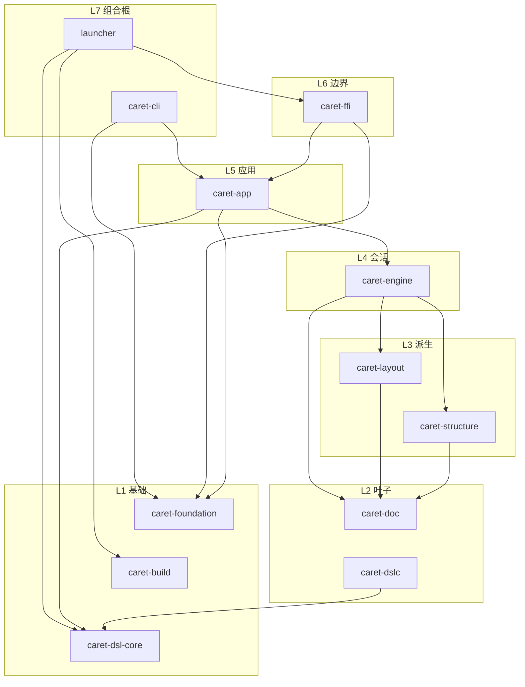
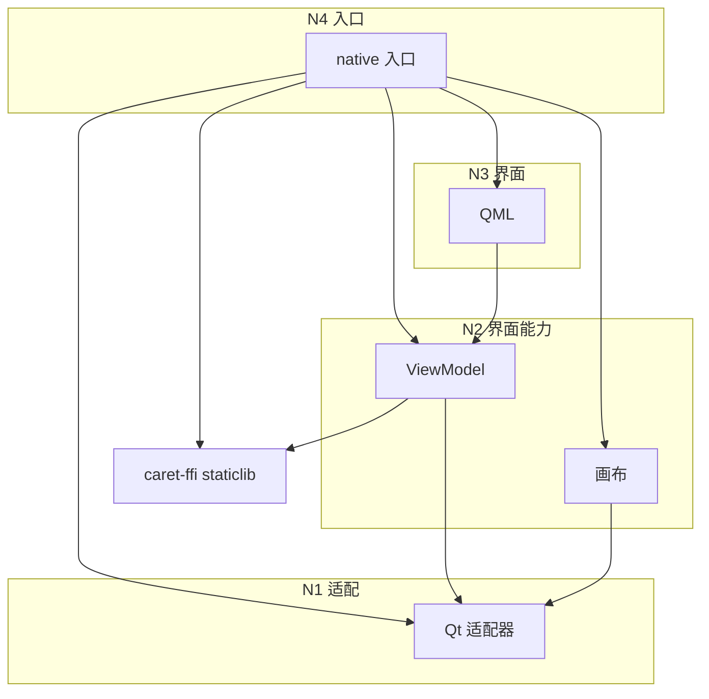

# 分层与依赖方向

更新日期：2026-10-25。本页定义 Rust 与 native 的目标依赖方向。基础设施 crate、CMake 目标和 QML 模块已有一部分落地；编辑器领域 crate 仍是规划。下方图表示目标成员和允许边，不代表每条边都已配置。编辑器模块见[仓库结构](../architecture/core/repository-layout.md)，没有消费者之前不建空 crate。

层号越小越靠下。生产代码只能依赖更小的层，不能依赖同层的另一个成员，也不能依赖更大的层。Rust 的层号和 Native 的层号各算各的。测试可以依赖被测对象，生产代码不能依赖测试。

图里的箭头是允许的依赖，从依赖方指向被依赖方；以实际 Cargo manifest 和配置后的 CMake 图确认当前已建立的边。同层成员之间没有边。

## 依赖图

`caret-foundation`、`caret-build`、`caret-dsl-core` 没有指向其他 workspace crate 的边。`caret-doc`、布局、结构索引和会话在需要时可以指向 `caret-foundation`，图里不再重复这几条边。画布和 ViewModel 互不依赖，由 native 入口把它们接在一起。逐帧绘制、命中和输入留在画布里；跨到 Rust 的是命令和页面快照，不是每个指针事件。

## Rust 分级

| 级 | 成员 | 允许依赖 |
| --- | --- | --- |
| L1 基础 | `caret-foundation`、`caret-build`、`caret-dsl-core` | 不依赖其他 workspace crate |
| L2 叶子 | `caret-doc`、`caret-dslc` | `caret-doc` 只可到 `caret-foundation`。`caret-dslc` 只可到 `caret-dsl-core`。二者互不依赖 |
| L3 派生 | `caret-layout`、`caret-structure` | `caret-doc`，以及 `caret-foundation`。二者互不依赖 |
| L4 会话 | `caret-engine` | `caret-doc`、`caret-layout`、`caret-structure`、`caret-foundation` |
| L5 应用 | `caret-app` | `caret-engine`、`caret-dsl-core`、`caret-foundation`。需要文档类型时可以再依赖 `caret-doc` |
| L6 边界 | `caret-ffi` | `caret-app`、`caret-foundation` |
| L7 组合根 | launcher、`caret-cli` | launcher 可到 `caret-ffi`、`caret-build`、`caret-dsl-core`。`caret-cli` 可到 `caret-app`、`caret-foundation`。二者互不依赖 |

`caret-dslc` 是独立的 `.pa` 检查和格式化命令，不是应用命令行，也不是桌面程序的组合根。`caret-build` 只供给工具，只有 launcher 和测试可以依赖它。L2 到 L6 和 `caret-cli` 不依赖 `caret-build`。`caret-ffi` 的 build script 可以依赖 `caret-build`，以便 CXX 与 native 使用同一份托管 Clang。运行时依赖 `caret-app`，只把已校验的内置主题快照交给桌面入口；仍然没有文档、命令或页面快照类型。

`caret-cli` 把参数适配成 `caret-app` 上的同一批命令。它不依赖 `caret-ffi`、`caret-engine` 或 Qt。`caret-app` 不依赖 `caret-ffi`。`caret-ffi` 不依赖 `caret-engine` 来绕过 `caret-app`。这样不会形成应用和边界之间的环，命令行也不会绕过应用服务。

## Native 分级

| 级 | 成员 | 允许依赖 |
| --- | --- | --- |
| N1 适配 | Qt 适配器 | Qt 和系统 API。不依赖 FFI、ViewModel、画布或 QML |
| N2 界面能力 | 画布、ViewModel | 都可以依赖 N1。ViewModel 还可以链接 `caret-ffi` 的 staticlib。画布和 ViewModel 互不链接 |
| N3 界面 | QML 模块 | 只依赖 ViewModel 暴露的类型。不链接 Rust，不链接画布 |
| N4 入口 | native 应用 | N1、画布、ViewModel、QML 模块，以及 `caret-ffi` 的 staticlib |

QML 表达意图。它不解析 `.pa`，不读写文档存储，不创建 Rust 对象。ViewModel 做 Qt 属性和参数转换，不实现文档事务。用户可见的行为由与 Qt 无关的 Rust 服务提供。界面和 `caret-cli` 提交同一种意图。命令 id 的目录写在[命令](../architecture/editor/commands.md)里。

## 边界

- `#[cxx::bridge]` 只声明映射和签名。FFI 实现只转换和转发。
- 小数据用值。大对象用说明了创建、释放、线程和失效行为的 opaque 所有者。整数句柄拒绝释放后复用。
- 可恢复的 C++ 异常在适配器变成结构化错误。panic 不是可恢复错误。
- 手写 unsafe 只留在已登记的崩溃模块。CXX 生成代码的 unsafe 按 [FFI](ffi.md) 审查，不扩散到业务调用方。
- 逻辑路径的宿主是 Qt 适配器；Rust 路径服务不包含 Qt 类型。

新增仓库内依赖时先改上面的图和分级表，再改 manifest 或 `target_link_libraries`。`cargo lint` 的 layering 检查读取 Cargo metadata，并配置专用 CMake 夹具核对 native 依赖边；评审仍以本页分级表为准。
