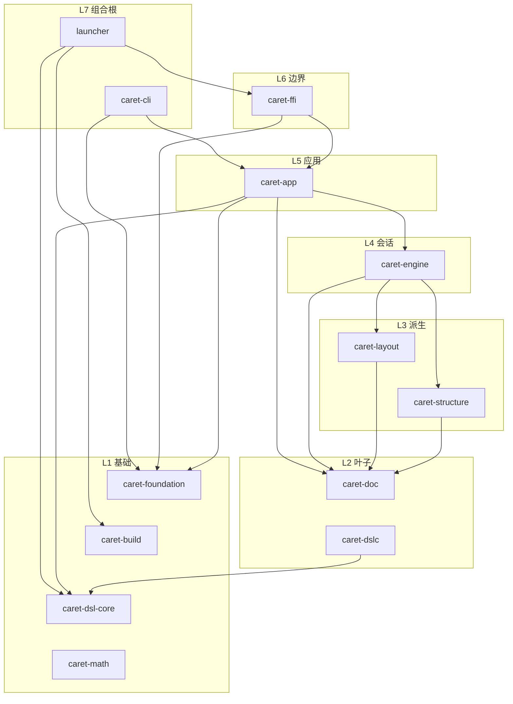
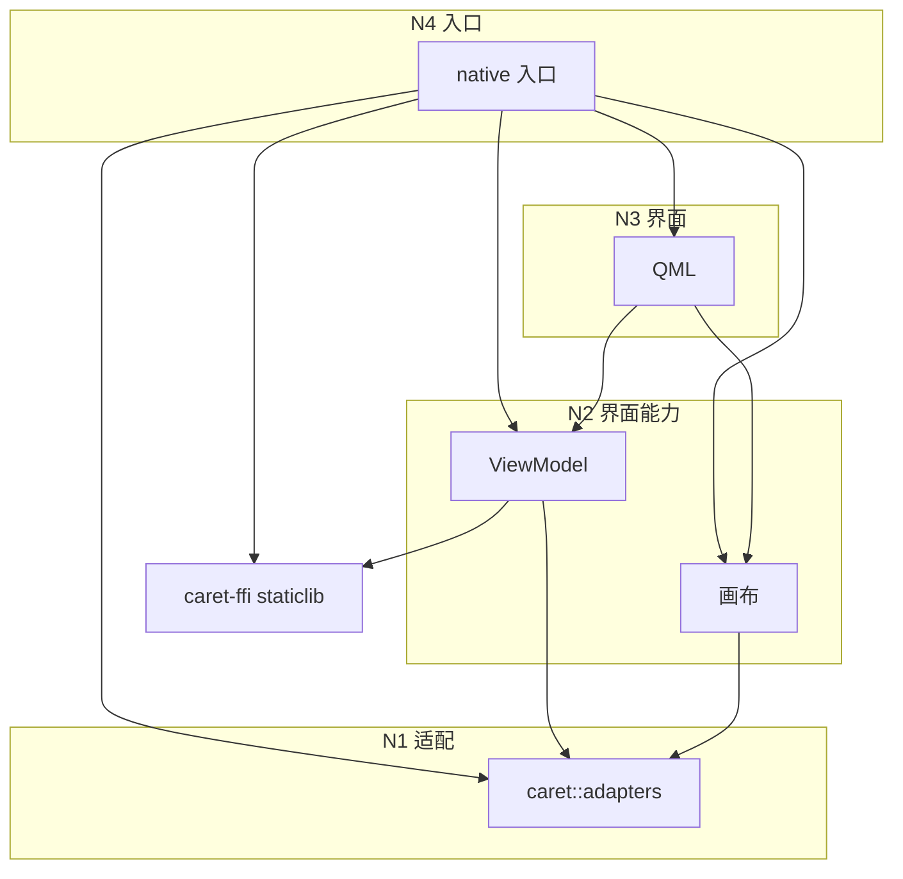

# 依赖图

更新日期：2026-10-30。本文集中展示 Rust crate 与 native 目标的允许依赖方向；层级规则和边界要求见[分层索引](../layering.md)。

`caret-foundation`、`caret-build`、`caret-dsl-core` 没有指向其他 workspace crate 的边。`caret-doc`、布局、结构索引和会话在需要时可以指向 `caret-foundation`，图里不再重复这几条边。画布和 ViewModel 互不依赖，由 native 入口把它们接在一起。逐帧绘制、命中和输入留在画布里；跨到 Rust 的是命令和页面快照，不是每个指针事件。
